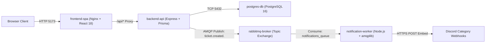
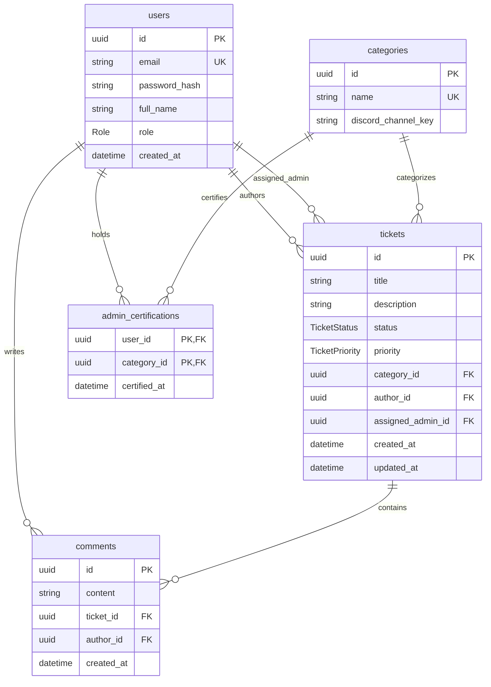
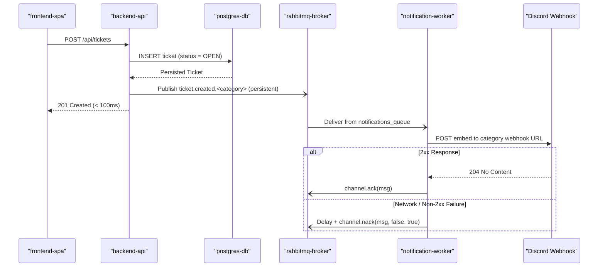

# Minimal Design & System Prototype Report

**Course:** Tools for Program Development  
**Milestone:** Intermediary Report - Minimal Design and Implementation (System Prototype)  
**Author:** Aurel Mihai Cristian  
**Group:** CEN S 4.1A

---

## 1. Intermediary Milestone Scope

This document describes the minimal architectural design and verified prototype implementation for the **Event-Driven IT Helpdesk & Incident Management System**, aligned with [project_specifications.md](./project_specifications.md).

### Included in Prototype
- Complete 5-container Docker Compose topology (`frontend-spa`, `backend-api`, `postgres-db`, `rabbitmq-broker`, `notification-worker`) with healthchecks and startup ordering (`condition: service_healthy`).
- PostgreSQL 16 relational schema managed via Prisma ORM migrations (`20261122182153_init`) and an idempotent seed script (`backend/prisma/seed.ts`).
- Express + TypeScript REST API with JWT authentication, `bcrypt` password hashing, Zod validation, centralized error handling, OpenAPI 3.0.3 Swagger docs (`/api/docs`), and strict Prisma-level Category-Based Access Control (CBAC).
- Asynchronous RabbitMQ topic exchange (`helpdesk_topic_exchange`) publishing `ticket.created.<category>` events consumed by a standalone worker (`notification-worker`) that maps categories to Discord channel webhooks (`DISCORD_WEBHOOK_HW`, `DISCORD_WEBHOOK_SW`, `DISCORD_WEBHOOK_LIC`, `DISCORD_WEBHOOK_NET`).
- Responsive 6-view React 18 + Bootstrap 5 SPA served by Nginx with `/api/` reverse proxying, TanStack Query caching, React Hook Form + Zod validation, and Chart.js admin analytics.

### Deferred to Final Stage
- Automated Jest and Supertest unit/API test suites (`backend/`).
- Automated cross-browser Playwright E2E test specifications (`e2e/auth.spec.ts`, `create-ticket.spec.ts`, `admin-cbac.spec.ts`).
- GitHub Actions CI/CD workflow automation.

---

## 2. System Architecture & Container Topology

All runtime services communicate over an isolated Docker bridge network (`helpdesk-net`). Only `frontend-spa`, `backend-api`, `postgres-db`, and `rabbitmq-broker` expose host ports; `notification-worker` runs exclusively as an internal AMQP consumer.

| Service | Base / Runtime Image | Internal Port | Host Mapping | Healthcheck / Dependency |
| :--- | :--- | :--- | :--- | :--- |
| `postgres-db` | `postgres:16-alpine` | `5432` | `5432` | `pg_isready`, named volume `pgdata` |
| `rabbitmq-broker` | `rabbitmq:3-management-alpine` | `5672`, `15672` | `5672`, `15672` | `rabbitmq-diagnostics -q ping`, named volume `rabbitmq_data` |
| `backend-api` | `node:20-alpine` (multi-stage) | `3000` | `3000` | HTTP `GET /api/health`; depends on healthy DB & broker |
| `notification-worker` | `node:20-alpine` (multi-stage) | None | None | Startup retry loop; depends on healthy `rabbitmq-broker` |
| `frontend-spa` | `nginx:1.27-alpine` (multi-stage) | `80` | `5173` | Depends on healthy `backend-api` |

---

## 3. Relational Database Design (PostgreSQL 16 & Prisma ORM)

The schema in `backend/prisma/schema.prisma` models five relational tables and three enums (`Role`, `TicketStatus`, `TicketPriority`), supporting Many-to-Many admin certifications through the `admin_certifications` join table.

### Schema Highlights & Idempotent Seeding
- **Composite Primary Key:** `admin_certifications` uses `@@id([userId, categoryId])` with `onDelete: Cascade` to prevent duplicate certifications per admin/category pair.
- **Query Indexes:** Secondary indexes are defined on `tickets(category_id)`, `tickets(author_id)`, `tickets(status)`, and `comments(ticket_id)`.
- **Idempotent Seed (`backend/prisma/seed.ts`):** Uses `upsert` on unique names, emails, composite certification keys, and fixed UUIDs to seed four categories (`HARDWARE`, `SOFTWARE`, `LICENSES`, `NETWORK`), one standard user, three certified admins (`admin.hw`, `admin.lic`, `admin.sw`), two sample tickets, and one comment safely across repeated executions.

---

## 4. Security, Validation & Category-Based Access Control (CBAC)

- **Authentication & Passwords:** Passwords are hashed using `bcrypt` (cost factor `10`). Successful login or registration returns a signed JWT (`sub`, `email`, `role`) verified by `requireAuth` on protected routes.
- **Role Guard:** `requireRole('ADMIN')` rejects standard users (`403 Forbidden`) on `/api/admin/*` and `PATCH /api/tickets/:id/status`.
- **Input Validation & Error Format:** All bodies, query strings, and UUID route parameters are validated with Zod (`backend/src/controllers/`). Centralized middleware (`backend/src/middleware/error.middleware.ts`) returns consistent `{ error: string, details?: unknown }` JSON payloads for `AppError`, `ZodError`, and Prisma errors (`P2002`, `P2025`, `P2003`).
- **Strict Prisma-Level CBAC (`backend/src/services/ticket.service.ts`):**
  - `GET /api/admin/tickets` queries `admin_certifications` for the authenticated admin and restricts Prisma `where` clauses with `categoryId: { in: certifiedCategoryIds }`. If an optional `categoryId` filter is supplied for an uncertified category, the `AND` intersection guarantees zero uncertified rows are returned.
  - `GET /api/tickets/:id` and `POST /api/tickets/:id/comments` allow access only if the actor authored the ticket or holds a matching `[userId, categoryId]` row in `admin_certifications`; otherwise `403 Forbidden` is thrown.
  - `PATCH /api/tickets/:id/status` verifies `[adminId, ticket.categoryId]` certification before updating `status` and setting `assignedAdminId`.
  - `GET /api/admin/analytics` runs `count` and `groupBy` aggregations strictly scoped to `categoryId: { in: certifiedCategoryIds }`.

---

## 5. REST API Contract Summary

Interactive OpenAPI 3.0.3 documentation is exposed at `/api/docs` (JSON schema at `/api/docs.json`).

| Method & Path | Access Level | Responsibility | Success Status |
| :--- | :--- | :--- | :--- |
| `GET /api/health` | Public | Verifies API uptime and PostgreSQL `SELECT 1` connectivity | `200` / `503` |
| `POST /api/auth/register` | Public | Registers a `USER` account and issues JWT | `201` |
| `POST /api/auth/login` | Public | Authenticates user/admin and issues JWT + certifications | `200` |
| `GET /api/auth/me` | Authenticated | Returns current user profile and active certifications | `200` |
| `GET /api/categories` | Authenticated | Returns ordered support categories for form dropdowns | `200` |
| `POST /api/tickets` | Authenticated | Persists categorized ticket (`OPEN`) and publishes AMQP event | `201` |
| `GET /api/tickets` | Authenticated | Lists paginated/filtered tickets authored by current user | `200` |
| `GET /api/tickets/:id` | Owner / Certified Admin | Returns ticket metadata and chronological comment thread | `200` |
| `PATCH /api/tickets/:id/status` | Certified Admin | Updates ticket status and assigns authenticated admin | `200` |
| `POST /api/tickets/:id/comments` | Owner / Certified Admin | Appends a comment to the ticket thread | `201` |
| `GET /api/admin/tickets` | Admin (CBAC) | Lists paginated/filtered tickets matching admin certifications | `200` |
| `GET /api/admin/analytics` | Admin (CBAC) | Returns certifications and counts by Category, Priority, Status | `200` |

---

## 6. Event-Driven Notification Pipeline

To keep ticket creation latency low and isolate third-party HTTP calls, Discord delivery is fully decoupled through RabbitMQ:

### Reliability & Category Routing Rules
- **Durable Broker Topology:** `helpdesk_topic_exchange` (`topic`) and `notifications_queue` are declared with `durable: true` and bound using `ticket.created.*`; published messages set `persistent: true`.
- **Category Webhook Mapping (`worker/src/services/webhook.service.ts`):**
  - `HARDWARE` -> `DISCORD_WEBHOOK_HW` (`#hw-support`)
  - `SOFTWARE` -> `DISCORD_WEBHOOK_SW` (`#sw-support`)
  - `LICENSES` -> `DISCORD_WEBHOOK_LIC` (`#licensing`)
  - `NETWORK` -> `DISCORD_WEBHOOK_NET` (`#net-support`)
- **Fault Tolerance:** The worker sets `prefetch(1)`, parses payloads via Zod (discarding malformed messages with `nack(msg, false, false)`), acknowledges (`ack`) only after `2xx` delivery or graceful skip when a webhook URL is unconfigured, and requeues (`nack(msg, false, true)` after `RETRY_DELAY_MS`) when Discord is unreachable. Both `backend-api` and `notification-worker` implement startup connection retry loops.

---

## 7. Frontend SPA Prototype (React 18 + Bootstrap 5)

The frontend uses a single shared `MainLayout` (`frontend/src/components/MainLayout.tsx`) with a dark top navigation bar, role indicator badge, `#f8f9fa` page background, and standard Bootstrap 5 cards, tables, forms, badges, and pagination.

| Route | Component | Access Guard | Key Capabilities |
| :--- | :--- | :--- | :--- |
| `/login` | `LoginPage` | `GuestOnlyRoute` | Zod-validated login form, JWT persistence, role-based redirect |
| `/register` | `RegisterPage` | `GuestOnlyRoute` | Zod-validated employee registration with password confirmation |
| `/dashboard` | `DashboardPage` | `ProtectedRoute` | Paginated user ticket table with search, status, priority, category filters |
| `/tickets/new` | `CreateTicketPage` | `ProtectedRoute` | Mandatory DB-populated category dropdown, priority selector, description |
| `/tickets/:id` | `TicketDetailPage` | `ProtectedRoute` | Ticket metadata, chronological comments, status control for certified admins |
| `/admin` | `AdminBoardPage` | `AdminRoute` | Certification badges, CBAC-filtered ticket table, inline status updates |
| `/analytics` | `AnalyticsPage` | `AdminRoute` | Active certification summary, KPI cards, Chart.js Category/Priority/Status charts |

---

## 8. Prototype Verification Summary

All implemented components were verified against the running 5-container Docker Compose stack:

- **Static Analysis & Production Builds:** `npm run typecheck` (`tsc --noEmit`), `npm run lint` (`eslint .`), and `npm run build` passed with zero errors across `backend/`, `worker/`, and `frontend/`.
- **Database Migration & Seed Idempotency:** Applied migration `20261122182153_init` cleanly to PostgreSQL 16 and verified `npm run prisma:seed` runs repeatedly without duplicating rows.
- **Nginx Reverse Proxy & SPA Routing (`http://localhost:5173`):** Confirmed `GET /` and `GET /admin` serve `200` SPA HTML, while `GET /api/health` and `GET /api/docs.json` proxy cleanly to `backend-api:3000`.
- **End-to-End 5-Container Walkthrough (via `http://localhost:5173/api`):**
  - Registered a standard user (`201`), retrieved profile (`200`), loaded 4 categories (`200`), and submitted a `CRITICAL` `HARDWARE` ticket (`201 Created` in `42ms`).
  - Verified `notification-worker` consumed the `ticket.created.hardware` message from `notifications_queue` and routed it to the `HARDWARE` (`#hw-support`) handler.
  - Verified CBAC isolation: `admin.lic@helpdesk.local` (`LICENSES`) saw zero `HARDWARE` tickets on `GET /api/admin/tickets` and received `403 Forbidden` on `GET`, `PATCH /status`, and `POST /comments` for the `HARDWARE` ticket.
  - Verified `admin.hw@helpdesk.local` (`HARDWARE`) viewed the ticket on `/api/admin/tickets`, resolved it (`PATCH /status` -> `200`, `RESOLVED`), posted a comment (`201`), and retrieved `HARDWARE`-scoped metrics from `GET /api/admin/analytics` (`200`).
