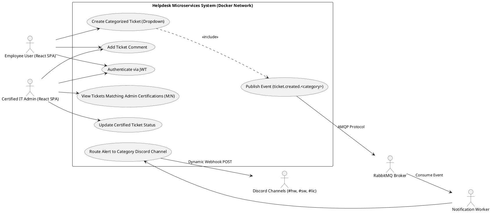

# Event-Driven IT Helpdesk & Incident Management System

**Course Project Report – Tools for Program Development**  
**Author:** Aurel Mihai Cristian  
**Group:** CEN S 4.1A

---

## 1. Executive Summary & Project Scope

The **IT Helpdesk & Incident Management System** is a full-stack, cloud-native web application designed to streamline internal technical support workflows within an organization or university campus. While the core business domain focuses on transparent incident lifecycle management (creating, tracking, commenting, and resolving support tickets), the primary engineering objective of this project is the implementation of a modern, automated **software development lifecycle (SDLC) ecosystem**.

To achieve high decoupling, fault tolerance, and rapid response times, the system is engineered using a **containerized microservices and event-driven architecture**. Rather than blocking HTTP requests while communicating with third-party notification providers, the backend publishes domain events asynchronously to a **RabbitMQ** message broker, which are subsequently consumed by a dedicated worker service that dispatches rich real-time alerts to an IT support channel via **Discord / Slack Webhooks**.

---

## 2. Detailed System Specifications

### 2.1 User Roles and Access Control

Access to application views and API endpoints is governed by stateless authentication using **JSON Web Tokens (JWT)** and **Role-Based Access Control (RBAC)**:

- **Standard User (Reporter):** Authenticated users who can submit new support tickets, assign priority levels, monitor the real-time status of their own submitted incidents, and participate in ticket discussion threads.
- **IT Administrator (`ADMIN` - Certified Specialist):** Support engineers assigned to one or more technical domains via a **Many-to-Many certification mapping** (`HARDWARE`, `SOFTWARE`, `LICENSES`, `NETWORK`). Using Category-Based Access Control (CBAC), administrators can only view, claim, and update tickets on their dashboard if the ticket's category matches at least one of their active account certifications.
- **External Notification System (Discord / Slack API):** An automated external actor triggered asynchronously whenever high-visibility ticket events occur.

### 2.2 Frontend Architecture (6-Page Responsive React SPA)

The client application is built as a responsive Single Page Application (SPA) using **React 18**, **TypeScript**, and **Bootstrap 5**. It enforces a consistent visual layout (shared navigation bar, role indicator, and responsive grid) across six distinct views managed by **React Router v6**:

| Route & View Name | Access Level | Functional Responsibilities & UI Components |
| :--- | :--- | :--- |
| `/login` & `/register` **Authentication Portal** | Public | Provides validated registration and login forms using React Hook Form. Stores the returned JWT in browser storage and redirects users based on their decoded role claim. |
| `/dashboard` **User Ticket Dashboard** | Authenticated (User / Admin) | Displays a paginated, filterable table of tickets submitted by the logged-in user, featuring color-coded status badges (Open, In Progress, Resolved) and priority tags. |
| `/tickets/new` **Create Ticket Form** | Authenticated (User / Admin) | Form managed via React Hook Form with Zod validation. Includes inputs for Title, Description, Priority (`LOW`, `MEDIUM`, `CRITICAL`), and a mandatory Category Dropdown (`HARDWARE`, `SOFTWARE`, `LICENSES`, `NETWORK`) dynamically populated from the database. Submitting triggers the asynchronous RabbitMQ topic routing pipeline. |
| `/tickets/:id` **Ticket Details & Thread** | Authenticated (Owner / Admin) | Presents full incident metadata, timestamps, and an interactive chronological comment thread allowing users and IT staff to exchange troubleshooting updates. |
| `/admin` **Admin Management Board** | Admin Only | Protected route restricted to the `ADMIN` role. Displays a centralized table/Kanban board strictly filtered at the API level based on the logged-in administrator's certifications (`AdminCertifications` join table). Uncertified ticket categories are completely hidden from the administrator's view. |
| `/analytics` **Analytics & Certifications Dashboard** | Admin Only | Displays active certification badges on the administrator's profile alongside Chart.js visualizations (`react-chartjs-2`) showing ticket distribution by Category, Priority, and Resolution Status. |

### 2.3 Relational Database Schema (PostgreSQL & Prisma ORM)

Persistent data is stored in a **PostgreSQL 16** relational database managed through declarative migrations using **Prisma ORM**. The data model consists of three core entities (extended with category and certification mapping tables):

- **User (`users`):** `id` (UUID, PK), `email` (Unique), `passwordHash`, `fullName`, `role` (`USER` | `ADMIN`), `createdAt`.
- **Categories Table:** `id` (UUID, PK), `name` (Unique: `HARDWARE`, `SOFTWARE`, `LICENSES`, `NETWORK`), `discordChannelKey` (maps to the corresponding Discord channel webhook).
- **AdminCertifications Join Table (Many-to-Many):** `userId` (FK -> `Users.id`), `categoryId` (FK -> `Categories.id`), `certifiedAt` (Timestamp). Composite Primary Key: `[userId, categoryId]`. Enforces domain-specific visibility for administrators.
- **Ticket (`tickets`):** `id` (UUID, PK), `title`, `description`, `status` (`OPEN` | `IN_PROGRESS` | `RESOLVED`), `priority` (`LOW` | `MEDIUM` | `CRITICAL`), `categoryId` (FK -> `Categories.id`), `authorId` (FK -> `Users.id`), `assignedAdminId` (FK -> `Users.id`, Nullable), `createdAt`, `updatedAt`.
- **Comments Table:** `id` (UUID, PK), `content`, `ticketId` (FK -> `Tickets.id`), `authorId` (FK -> `Users.id`), `createdAt`.

### 2.4 Non-Functional Requirements

- **Asynchronous Decoupling & Low Latency:** Ticket creation HTTP requests must respond to the React client in under 100ms by offloading external Discord/Slack HTTP calls to RabbitMQ.
- **Fault Tolerance:** If the external Discord/Slack API is temporarily unreachable, messages must remain safely queued in RabbitMQ with unacknowledged status until delivery succeeds.
- **Environment Reproducibility:** The complete stack must boot deterministically on any host operating system (macOS, Linux, Windows) via a single `docker compose up --build` command.

---

## 3. Development Tools, Frameworks & Container Architecture

To satisfy the core requirements of the *Tools for Program Development* curriculum, the application integrates a modern industrial toolchain covering container orchestration, ORM database migrations, asynchronous message brokering, static code analysis, API documentation, and automated End-to-End (E2E) testing.

### 3.1 Five-Container Docker Compose Topology

The runtime infrastructure is isolated within an internal Docker bridge network (`helpdesk-net`) and orchestrated across five distinct containers:

| Container Name | Base Image & Technologies | Internal Port | Role in System Architecture |
| :--- | :--- | :--- | :--- |
| `frontend-spa` | Node 20 (build) / Nginx Alpine, React 18, Vite, TypeScript, Bootstrap 5, TanStack Query | `80` (mapped to `5173`) | Serves the compiled React production bundle and proxies API calls to the backend service. |
| `backend-api` | Node 20 Alpine, NestJS (or Express + TS), Prisma Client, Passport-JWT, Swagger | `3000` | Exposes RESTful endpoints, enforces JWT/RBAC security, queries PostgreSQL, and publishes AMQP events. |
| `postgres-db` | `postgres:16-alpine` with persistent volume (`pgdata`) | `5432` | ACID-compliant relational storage for users, tickets, and comments. |
| `rabbitmq-broker` | `rabbitmq:3-management-alpine` | `5672` (AMQP) `15672` (UI) | Implements an asynchronous Topic Exchange (`helpdesk_topic_exchange`). Routes incoming ticket events using dynamic routing keys (`ticket.created.<category>`) to ensure category-specific message delivery and provides the Management UI on port 15672. |
| `notification-worker` | Node.js + TypeScript + `amqplib` + Axios | None (Internal Consumer) | Standalone background worker listening to the RabbitMQ queue. Reads the ticket's `category` attribute from the message payload and dynamically selects the matching Discord/Slack Webhook URL (`DISCORD_WEBHOOK_HW`, `DISCORD_WEBHOOK_SW`, `DISCORD_WEBHOOK_LIC`), ensuring hardware incidents only alert the `#hw-support` channel, software incidents alert `#sw-support`, etc. |

### 3.2 Software Engineering & Quality Assurance Toolchain

| Category | Tool / Framework | Purpose and Integration in Project Workflow |
| :--- | :--- | :--- |
| **Version Control & CI/CD** | Git, GitHub & GitHub Actions | Feature-branch workflow with automated CI pipelines triggered on every push and Pull Request to build containers and run test suites. |
| **E2E Browser Automation** | Playwright (TypeScript) | Executes automated cross-browser tests (Chromium, Firefox, WebKit) validating authentication, ticket creation, and admin status transitions. |
| **Unit & API Testing** | Jest & Supertest | Validates backend service logic, JWT guards, and REST controller response payloads in isolation. |
| **API Documentation** | Swagger / OpenAPI 3.0 | Auto-generates an interactive API portal at `/api/docs` allowing live endpoint testing and schema inspection. |
| **Code Quality & Linting** | ESLint & Prettier | Enforces strict TypeScript type safety, consistent formatting, and static detection of anti-patterns prior to commit. |

---

## 4. Use Case Diagram & Behavioral Specifications

The diagram below illustrates the interactions between human actors (Standard User and IT Administrator), the core Helpdesk application boundary, the asynchronous RabbitMQ broker, the Notification Worker, and the external Discord/Slack API.

*(See Appendix for the complete reproducible PlantUML source code of the Use Case Diagram covering: Employee User (React SPA), Certified IT Admin (React SPA), RabbitMQ Broker, Notification Worker, and Discord Channels (`#hw`, `#sw`, `#lic`) within the Helpdesk Microservices System (Docker Network).)*

### 4.1 Detailed Use Case Specifications

#### Use Case UC2: Create Categorized Ticket (with Topic Routing)

| Specification Field | Description |
| :--- | :--- |
| **Primary Actor** | Authenticated User (`USER`) |
| **Preconditions** | The user is authenticated via JWT and is on the `/tickets/new` React page. |
| **Main Success Scenario** | 1. The user fills in the ticket Title, Description, selects a Priority level, and chooses a technical domain from the Category Dropdown (e.g., `HARDWARE`, `SOFTWARE`, `LICENSES`). 2. The user clicks "Submit Ticket", triggering an HTTP POST request to `POST /api/tickets`. 3. The Backend API validates the payload and inserts the new ticket into PostgreSQL via Prisma ORM, linking it to the selected `categoryId` with default status `OPEN`. 4. The Backend API publishes an event message to the RabbitMQ exchange with the routing key `ticket.created.<category>` and immediately returns `201 Created` to the React client. |
| **Postconditions** | The categorized ticket is stored in PostgreSQL and queued for channel-specific Discord routing. |

#### Use Case UC4: Certification-Filtered Admin Dashboard & Status Update

| Specification Field | Description |
| :--- | :--- |
| **Primary Actor** | IT Administrator (`ADMIN`) |
| **Preconditions** | The administrator is authenticated, holds the `ADMIN` role, and has at least one category assigned in the `AdminCertifications` join table. |
| **Main Success Scenario** | 1. The administrator navigates to the `/admin` board in the React SPA. 2. The Backend API queries the `AdminCertifications` table for the admin's `userId` and retrieves **only** the tickets whose `categoryId` matches the administrator's certified categories. 3. The administrator selects a visible ticket and updates its status from `OPEN` to `IN_PROGRESS` or `RESOLVED` via `PATCH /api/tickets/:id/status`. 4. The Backend verifies that the admin holds the certification required for that ticket's category, updates PostgreSQL, and refreshes the UI state via React Query. |
| **Postconditions** | The ticket status is updated while enforcing strict domain isolation between support teams. |

#### Use Case UC6: Asynchronous Category-Based Discord Routing

| Specification Field | Description |
| :--- | :--- |
| **Actors & Components** | Core Backend API (Producer), RabbitMQ Broker, Notification Worker (Consumer), Discord Webhook API. |
| **Preconditions** | UC2 has persisted a categorized ticket in PostgreSQL. |
| **Main Success Scenario** | 1. The Backend API publishes a JSON payload (`ticketId`, `title`, `priority`, `category`, `authorEmail`) to the RabbitMQ `notifications_queue`. 2. The `notification-worker` container consumes the message asynchronously via the AMQP protocol. 3. The Worker inspects the `category` field (e.g., `HARDWARE`) and maps it to the corresponding dedicated environment variable (`DISCORD_WEBHOOK_HW` -> `#hw-support` channel, `DISCORD_WEBHOOK_SW` -> `#sw-support` channel, `DISCORD_WEBHOOK_LIC` -> `#licensing` channel). 4. The Worker dispatches a formatted HTTP POST embed to the target Discord Webhook URL and sends an `ACK` signal to RabbitMQ upon receiving a `204 No Content` response. |
| **Alternative Flow (Fault Tolerance)** | If the target Discord webhook is unreachable, the Worker withholds the `ACK` signal, preserving the message in RabbitMQ for automatic retry without impacting the main web application. |

---

## 5. Automated End-to-End (E2E) Testing & CI Workflow

To guarantee end-to-end reliability across the containerized stack, **Playwright** is integrated into the frontend repository and automated via **GitHub Actions**. During continuous integration runs, the workflow spins up the Docker Compose stack, runs Prisma schema migrations, seeds test accounts, and executes three critical E2E test specifications in headless Chromium:

- **Spec 1 – Authentication & Route Protection (`auth.spec.ts`):** Verifies that unauthenticated users attempting to visit `/dashboard` or `/admin` are redirected to `/login`, and confirms successful JWT login flow.
- **Spec 2 – Full Ticket Creation Flow (`create-ticket.spec.ts`):** Automates filling out the incident creation form with priority `CRITICAL`, intercepts the `201 Created` API response, and asserts that the newly created ticket renders inside the React dashboard table.
- **Spec 3 – Certification-Based Access Control & Status Flow (`admin-cbac.spec.ts`):** Playwright creates a new ticket under the `HARDWARE` category as a standard user. Next, it logs in as an Administrator certified only in `LICENSES`, navigates to `/admin`, and asserts that the `HARDWARE` ticket is not rendered in the DOM table. Finally, it logs in as a `HARDWARE`-certified Administrator, verifies that the ticket is visible, changes its status to `RESOLVED`, and asserts the UI badge update.

---

## Appendix – Reproducible PlantUML Source Code for Use Case Diagram

